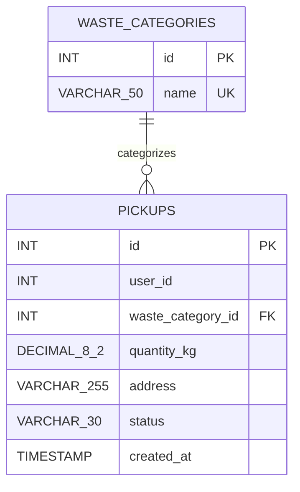

# Smart Waste Recycling System — ER Diagram

## Entities and Relationships

## Entity Descriptions

### 1. WASTE_CATEGORIES

Stores the types of recyclable waste.

- `id`: Primary key; automatically generated.
- `name`: Waste category name; must be unique.

### 2. PICKUPS

Stores waste collection requests.

- `id`: Primary key; automatically generated.
- `user_id`: ID of the requesting user.
- `waste_category_id`: Foreign key referencing `WASTE_CATEGORIES.id`.
- `quantity_kg`: Quantity of waste in kilograms.
- `address`: Pickup location.
- `status`: Current pickup status; defaults to Pending.
- `created_at`: Timestamp when the request was created.

## Relationship

One waste category can be associated with zero or many pickup requests. Each pickup request references exactly one waste category.

The `user_id` column is not currently connected to a users table because that table has not yet been implemented.
